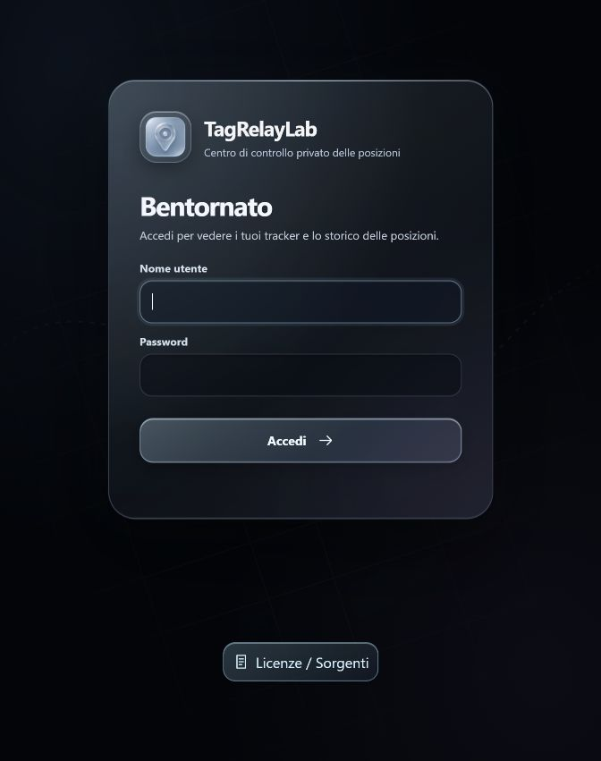
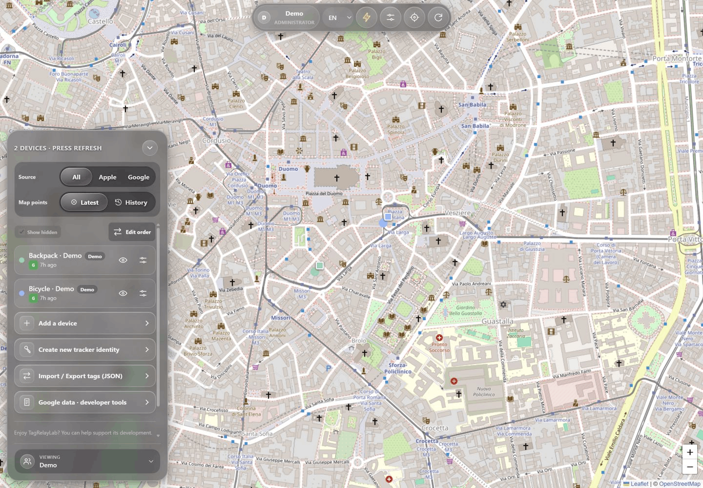
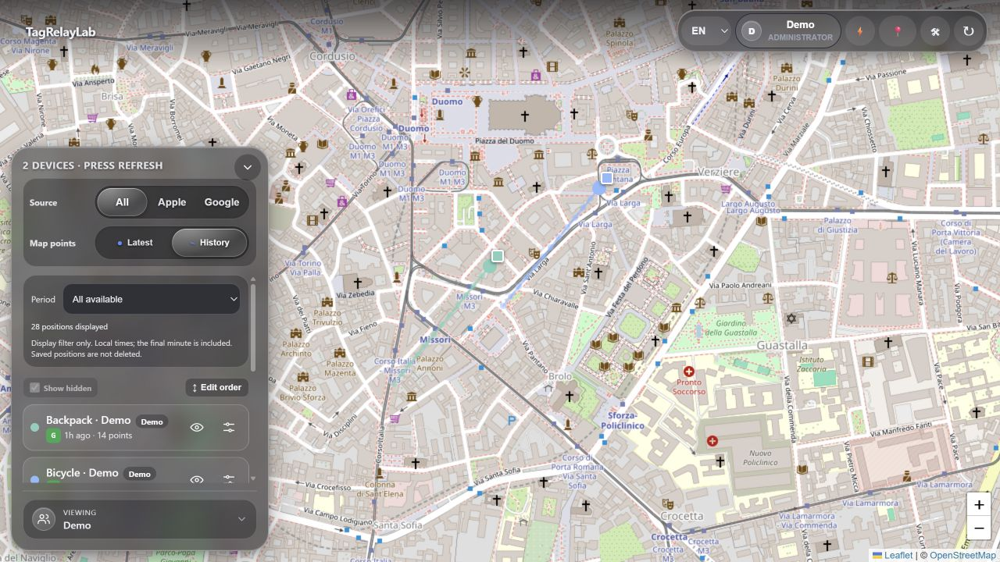

# Interface gallery

Older screenshots retain the earlier Find My Web / Find My Hub branding; the illustrated workflows still apply.

## Map appearance and persistent controls (1.1.32)

Real application captures with synthetic demonstration positions. More,
Administration, Location and Refresh stay accessible. The secondary panel
contains account, language, appearance and firmware links.

| View | Screenshot |
| --- | --- |
| Glass secondary panel and dark tile color style | [Map appearance](36-map-appearance.jpg) |
| Closed panel with all primary controls available | [Persistent toolbar](37-map-toolbar.jpg) |

Light, Dark and System are local color treatments of the same OpenStreetMap
tiles, not satellite imagery or a different cartography service. Marker colors
and stored positions are not changed.

## Glass sign-in (1.1.31)

The black sign-in page uses the same layered glass as the map, restrained
sky-blue reflections and a decorative street pattern, without live positions
or the circular backdrop. Labels and controls remain readable.

## Readable glass and responsive navigation (1.1.30)

Real captures from the release candidate, using only synthetic accounts and
Milan demonstration positions. Provider connections are deliberately unset;
these images illustrate the interface, not live network tracking.

| View | Screenshot |
| --- | --- |
| Centered toolbar and compact device tools | [Desktop map](30-map-glass.png) |
| Separate, scrollable mobile account creation | [Accounts](31-accounts-mobile.png) |
| Ordered history controls without overlapping metadata | [Mobile history](32-history-mobile.png) |
| Administration with restrained colored glass and left-hand return | [Administration](33-admin-glass.png) |
| Consistent programming controls and page navigation | [ESP32 flasher](34-esp32-glass.png) |

## Consistent controls and settings (1.1.29)

Real application captures with synthetic accounts and positions. The shared
neutral theme also covers device settings, administration and firmware tools.
No real tracker keys or account credentials are shown.

| View | Screenshot |
| --- | --- |
| Account and map preferences | [Account](23-account-controls.png) |
| Provider and automation settings | [Administration](24-settings-controls.png) |
| Persistent device key labels on mobile | [Device controls](25-mobile-device-controls.png) |
| ESP32 programming tools | [Firmware controls](26-firmware-controls.png) |
| Proportioned mobile drawer close control | [Device drawer](27-mobile-drawer-controls.png) |

## Translucent map and mobile drawer (1.1.28)

These captures show the neutral translucent interface with synthetic data.
On phones, the outline button at the bottom left opens the device drawer.
The drawer shows source and history filters, the tracked devices, and, for administrators,
the account switcher. The down chevron returns to the full map.

| View | Screenshot |
| --- | --- |
| Desktop map and saved history | [Glass history](20-glass-history.png) |
| Mobile map with the device drawer closed | [Drawer closed](21-mobile-menu-closed.png) |
| Mobile device drawer with the account switcher | [Drawer open](22-mobile-menu-open.png) |

## Workflow reference

Captured from application version 1.1.15 and the 1.1.16/1.1.17/1.1.18 feature previews in isolated Docker environments with synthetic
devices, accounts, identities and locations. No real credentials or personal
tracking data were used. Provider services in this demo are unconfigured;
screenshots document controls, not a claim of live Apple/Google connectivity.
Open an image for its full-size version. Map attribution is retained.
The Google report image shows the compact 1.1.18 mobile layout with an expanded
report; explanatory text remains available under the collapsed Info and legend.

[English user guide](../USER_GUIDE.en.md) · [Animated tours](../demos/README.md)

Italian documentation

Schermate reali con dati dimostrativi, non informazioni personali.
[Guida italiana](../USER_GUIDE.it.md).

| Feature | Screenshot |
| --- | --- |
| Sign in | [01-login.jpg](01-login.jpg) |
| Map, sources, visibility | [02-map.jpg](02-map.jpg) |
| History date/time range | [03-history-range.jpg](03-history-range.jpg) |
| Unified views and members | [04-unified-view.jpg](04-unified-view.jpg) |
| Original-device settings | [05-device-settings.jpg](05-device-settings.jpg) |
| Apple/Google identity generation | [06-identities.jpg](06-identities.jpg) |
| Accounts and roles | [07-users.jpg](07-users.jpg) |
| Provider connections and onboarding | [08-provider-setup.jpg](08-provider-setup.jpg) |
| MQTT, Home Assistant and polling | [09-mqtt.jpg](09-mqtt.jpg) |
| Optional Traccar map | [10-traccar.jpg](10-traccar.jpg) |
| JSON export and complete backup | [11-backup.jpg](11-backup.jpg) |
| ESP32 flashing and BOOT guidance | [12-esp32-flasher.jpg](12-esp32-flasher.jpg) |
| Space-optimized configured library | [13-esp32-library.jpg](13-esp32-library.jpg) |
| Nordic boards, clock and motion | [14-nrf-flasher.jpg](14-nrf-flasher.jpg) |
| Mobile history navigation | [15-mobile-history.jpg](15-mobile-history.jpg) |
| Deliberate reordering | [16-order.jpg](16-order.jpg) |
| Deliberate identity rotation | [17-identity-rotation.jpg](17-identity-rotation.jpg) |
| Google raw archive and reliable result | [18-google-reliable-reports.jpg](18-google-reliable-reports.jpg) |
| Administrator reliability settings | [19-google-analysis-settings.jpg](19-google-analysis-settings.jpg) |

Maintenance: recapture only in a disposable environment, inspect every image
before publishing, and synchronize this directory and both guides with the
store catalog. Never capture a production map or reveal its identity fields.
